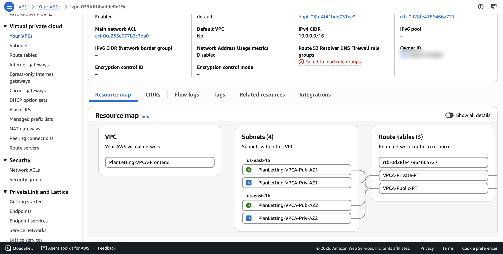
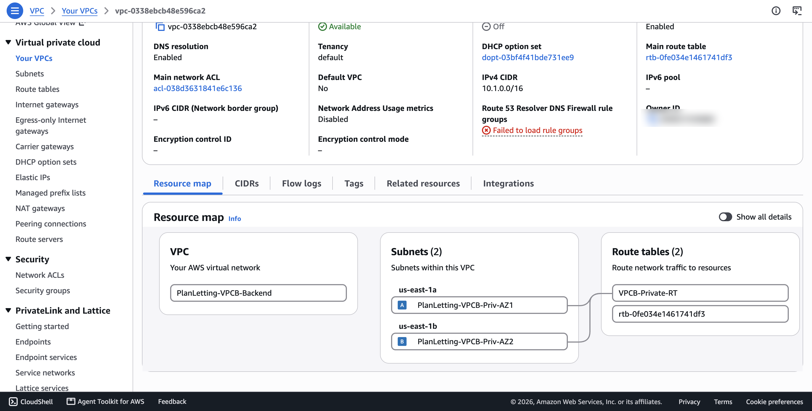
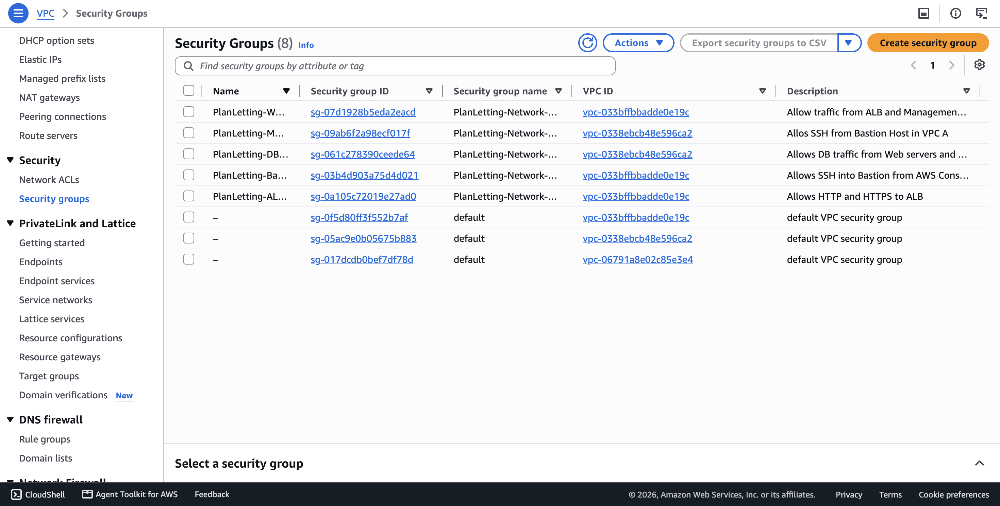
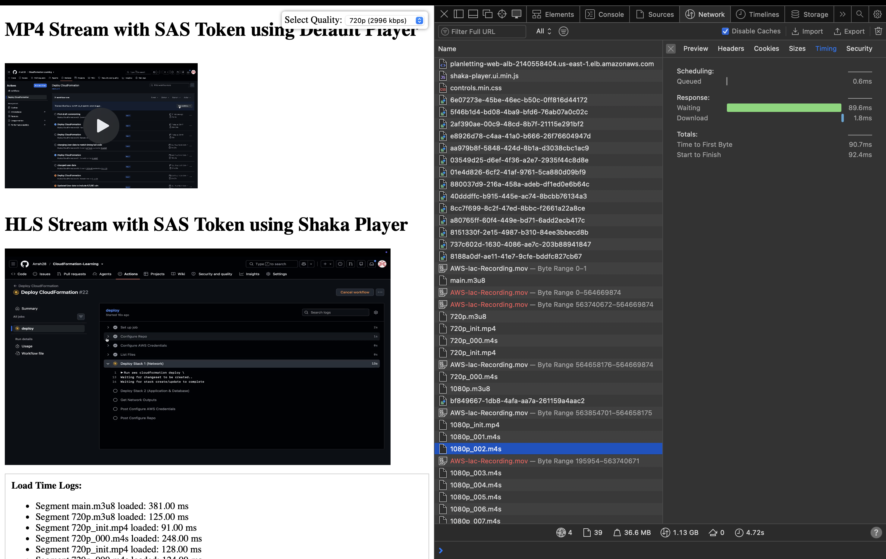

# Plan-Letting: Multi-Cloud Hospitality Platform (AWS + Azure)

A multi-cloud deployment for a fictional property-letting platform. The web application runs on **AWS** across two peered VPCs, built entirely with **CloudFormation** and deployed by a **GitHub Actions** pipeline. HD apartment-tour video is streamed with **HLS** from private **Azure Blob Storage** through **Azure Front Door**, configured with the Azure CLI.

Built for the *Software Defined Networks & Edge Services* (505AZ) module, BSc Cloud Engineering, Coventry University.

## Highlights

- **Two-stack IaC.** A network stack and an application stack, linked by CloudFormation exports and imports, so networking can change without redeploying compute.
- **Network segmentation.** VPC A (`10.0.0.0/16`) holds the public front end. VPC B (`10.1.0.0/16`) holds the database and management tier. VPC B has no internet gateway or NAT, so it is reachable only from VPC A over the peering connection.
- **Security groups chained by reference, not IP.** Internet → ALB → web servers → database. Each tier accepts traffic only from the security group in front of it.
- **High availability.** ALB and Auto Scaling group (min 2, max 4) spread across two Availability Zones; RDS MySQL primary plus a read replica.
- **Multi-cloud media delivery.** Adaptive-bitrate HLS (720p / 1080p) served from a private Blob container via Front Door with a read-only SAS, offloading video bandwidth from the AWS application.

## Architecture

### AWS (CloudFormation)

| Layer | VPC A: public services (`10.0.0.0/16`) | VPC B: private services (`10.1.0.0/16`) |
|---|---|---|
| Subnets | 2 public (`10.0.1.0/24`, `10.0.2.0/24`), 2 private (`10.0.11.0/24`, `10.0.12.0/24`) across 2 AZs | 2 private (`10.1.1.0/24`, `10.1.2.0/24`) across 2 AZs |
| Edge | Internet Gateway, internet-facing ALB, NAT Gateway for outbound updates | None: no IGW, no NAT |
| Compute | Auto Scaling group of Apache/PHP web servers in the private subnets; bastion host in a public subnet | Management EC2 instance |
| Data | | RDS MySQL primary (encrypted, 7-day backups, snapshot on delete) + read replica |
| Connectivity | VPC peering connection with routes in every route table (`10.0.0.0/16` ↔ `10.1.0.0/16`) | |

| VPC A resource map | VPC B resource map |
|---|---|
|  |  |

### Security group rules

| Security group | Allows in | From |
|---|---|---|
| ALB | TCP 80, 443 | Internet |
| Web servers | TCP 80 | ALB security group only |
| Web servers | SSH 22, ICMP | Management security group |
| Database | MySQL 3306 | Web server security group and management security group |
| Database | SSH 22, ICMP | Management security group |
| Management | SSH 22 | Bastion security group |
| Bastion | SSH 22 | Admin access |

Anything not listed is denied by default. The database is not publicly accessible and only accepts connections from the tiers that need it.



### Azure (CLI)

1. **Encode.** FFmpeg converts the source video into an HLS ladder: a master playlist (`main.m3u8`), one playlist per rendition (`720p.m3u8`, `1080p.m3u8`), and fragmented-MP4 segments (`*_init.mp4`, `*.m4s`).
2. **Store.** Segments are uploaded to a Blob container with anonymous access disabled.
3. **Deliver.** Azure Front Door uses the storage account as its origin, over HTTPS only, with caching enabled for playlists and segments.
4. **Authorise.** Requests carry a read-only, HTTPS-only SAS (`sp=r`, `spr=https`), appended to each segment request by a Shaka Player request filter.

## CI/CD pipeline

[`.github/workflows/main.yml`](.github/workflows/main.yml) runs on demand (`workflow_dispatch`):

1. Check out the repository.
2. Load AWS credentials from repository secrets.
3. `aws cloudformation deploy` the **network** stack.
4. `aws cloudformation deploy` the **application** stack, passing the database password from a GitHub secret (never stored in the repo).
5. Print the stack outputs (ALB URL, database endpoints).

`cloudformation deploy` creates a change set, so re-running the pipeline updates stacks in place instead of failing on existing resources.

## Results

The web app loads from the ALB and shows which server answered and whether it can reach both the primary database and the replica. Video plays in two ways for comparison:

| | Progressive MP4 | HLS via Front Door |
|---|---|---|
| Delivery | One large file, fetched with byte-range requests | Small segments, 720p and 1080p |
| Time to first byte (observed) | ~445 ms | ~91 ms per segment |
| Quality | Fixed | Player switches rendition as bandwidth changes |



## Repository layout

```
.github/workflows/main.yml   GitHub Actions pipeline
Templates/Network.yaml       Stack 1: VPCs, subnets, peering, routes, security groups
Templates/application.yaml   Stack 2: ALB, ASG, bastion, management EC2, RDS + replica
V1/                          First single-stack prototype, kept for comparison
docs/images/                 Diagrams and screenshots
```

## Deploy it yourself

Add these repository secrets: `AWS_ACCESS_KEY_ID`, `AWS_SECRET_ACCESS_KEY`, `AWS_SESSION_TOKEN`, `DB_PASSWORD`. Then run **Deploy CloudFormation** from the Actions tab. To tear down, delete `PlanLetting-App` first, then `PlanLetting-Network` (the app stack imports the network stack's exports).

## Known limitations and next steps

- **HTTP only on the ALB.** Add an HTTPS listener with an ACM certificate and redirect port 80.
- **Bastion SSH is open to the internet.** Restrict it to a known IP range, or replace the bastion with AWS Systems Manager Session Manager. The lab account's IAM limits ruled that out here.
- **Single-AZ primary database.** Enable RDS Multi-AZ for automatic failover; the read replica improves read capacity but does not fail over automatically.
- **SAS token in user data.** Move it to AWS Secrets Manager or SSM Parameter Store, or have the app issue short-lived SAS tokens on request.
- **Credentials in GitHub secrets.** Replace static keys with GitHub OIDC federation to an IAM role.
- **Pipeline checks.** Add `cfn-lint` and change-set review before deploy.
- **Azure as code.** Turn the CLI script into Bicep or Terraform.

## What I learned

- **Exports and imports make stacks loosely coupled.** But they also lock deletion order, which matters in a pipeline.
- **Security group references beat CIDR rules.** They keep working as Auto Scaling replaces instances.
- **Peering is not transitive and needs routes on both sides.** The connection alone moves no traffic.
- **HLS changes the cost model.** Segments are cacheable at the edge, so the origin serves each one once rather than once per viewer.
